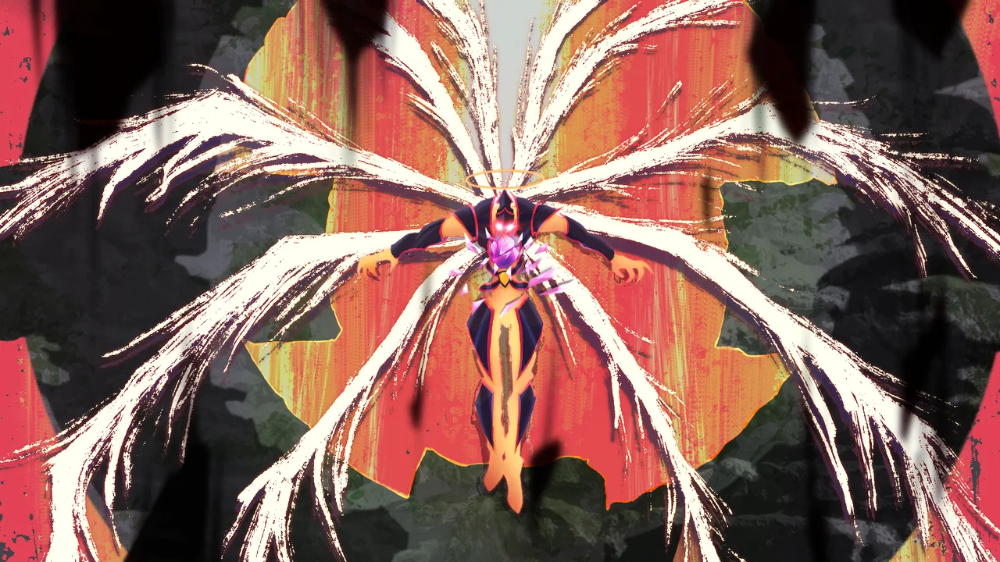

# Heart of Ruin

*A melee champion whose damage grows as health falls, with a self-shield and a stunning dash landing.*

## Kit

**Heart of Ruin**

**Passive:** Heart of Ruin gains up to 50% bonus damage based on missing % health. The bonus scales linearly: 0% at full health, 25% at half health, and up to 50% near zero health. Applies to all damage, including basic attacks and the dash landing; shields do not count as health.

### Slot 0: Self-shield

Grants a 1.5 × Focus shield lasting five turns.

- **Target / range:** Self
- **Walking:** Compatible
- **Cooldown:** 8 owner turn ends

### Slot 1: Dash

Dash to a destination within 2 tiles. Does 1.5 × Focus to the surrounding tiles on arrival and stuns enemies/camps hit. Hits within a Chebyshev radius of 1, including diagonals; stun lasts one turn. Damage is increased by the missing-health passive.

- **Target / range:** Ground · 2 tiles
- **Walking:** Compatible
- **Cooldown:** 8 owner turn ends

## Starting stats

| Stat | Base | Growth per matching shard |
| --- | --- | --- |
| Health | 1000 | 100 |
| Strength | 30 | 3 |
| Focus | 100 | 10 |

Attack type: Melee. Basic attack range: 1 tiles.

---

**See also:** [Champion roster](./README.md) · [Combat & abilities](../handbook/07-combat.md) · [Items & gold](../handbook/08-items.md)

Engine sources cited by the handbook: `game/Engine/include/private_cpp/Engine/Balance/Champions.h`, `game/Engine/include/private_cpp/Engine/Balance/ChampionPassives.h`, `game/Engine/include/private_cpp/Engine/Abilities/Designs.h`, `game/Engine/include/private_cpp/Engine/Passives/Designs.h`, `game/Engine/src/Game/Combat.cpp`
