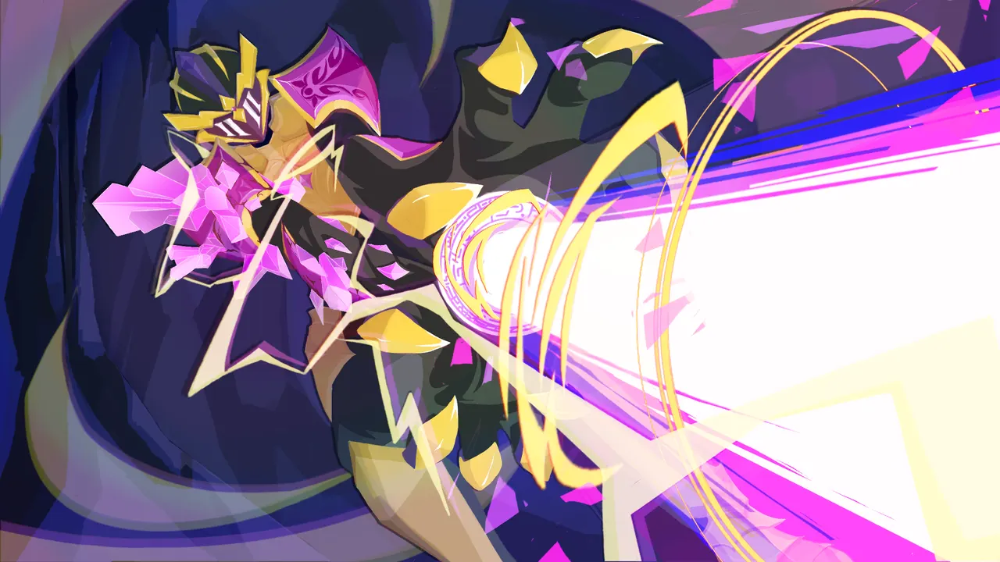

# Prism

*A ranged spellcaster who gains Focus from carried gems, trading safe tributes for temporary strength.*

## Kit

**Prism**

**Passive:** Prism gains 1.5 Focus per carried gem. Ten carried gems add 15 Focus. Tributing or losing those gems removes that bonus.

### Slot 0: Damage and stun

1.5 × Focus damage and a one-round stun.

- **Target / range:** Enemy or camp · 4
- **Walking:** Excludes walking
- **Cooldown:** 8 owner turn ends

### Slot 1: Area damage

1 × Focus damage in radius one.

- **Target / range:** Ground · 4
- **Walking:** Excludes walking
- **Cooldown:** 8 owner turn ends

## Starting stats

| Stat | Base | Growth per matching shard |
| --- | --- | --- |
| Health | 700 | 65 |
| Strength | 35 | 2.5 |
| Focus | 80 | 8 |

Attack type: Ranged. Basic attack range: 3 tiles.

---

**See also:** [Champion roster](./README.md) · [Combat & abilities](../handbook/07-combat.md) · [Items & gold](../handbook/08-items.md)

Engine sources cited by the handbook: `game/Engine/include/private_cpp/Engine/Balance/Champions.h`, `game/Engine/include/private_cpp/Engine/Balance/ChampionPassives.h`, `game/Engine/include/private_cpp/Engine/Abilities/Designs.h`, `game/Engine/include/private_cpp/Engine/Passives/Designs.h`, `game/Engine/src/Game/Combat.cpp`
