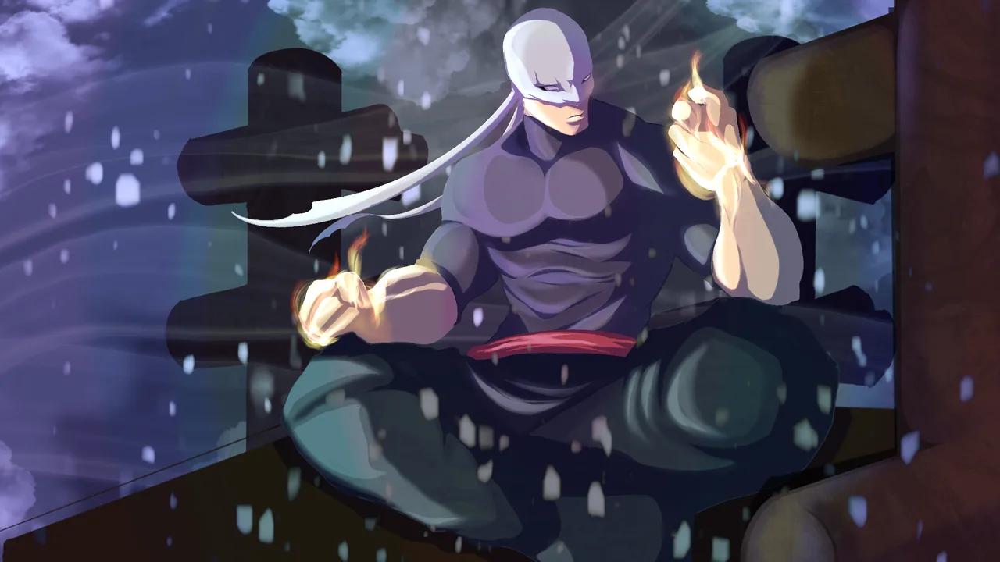

# Ren

*A melee champion with retaliation damage, a targeted stun and a short dash.*

## Kit

**Ren**

**Passive:** Retaliates against an attacker for 0.2 × Focus damage when damaged. Ren can still trigger retaliation as he dies.

### Slot 0: Damage and stun

1.25 × Focus damage and a one-round stun.

- **Target / range:** Enemy or camp · 4
- **Walking:** Excludes walking
- **Cooldown:** 8 owner turn ends

### Slot 1: Dash

Move up to 2 steps, including diagonals.

- **Target / range:** Ground · 2 tiles
- **Walking:** Compatible
- **Cooldown:** 8 owner turn ends

## Starting stats

| Stat | Base | Growth per matching shard |
| --- | --- | --- |
| Health | 900 | 100 |
| Strength | 40 | 5 |
| Focus | 100 | 10 |

Attack type: Melee. Basic attack range: 1 tiles.

---

**See also:** [Champion roster](./README.md) · [Combat & abilities](../handbook/07-combat.md) · [Items & gold](../handbook/08-items.md)

Engine sources cited by the handbook: `game/Engine/include/private_cpp/Engine/Balance/Champions.h`, `game/Engine/include/private_cpp/Engine/Balance/ChampionPassives.h`, `game/Engine/include/private_cpp/Engine/Abilities/Designs.h`, `game/Engine/include/private_cpp/Engine/Passives/Designs.h`, `game/Engine/src/Game/Combat.cpp`
