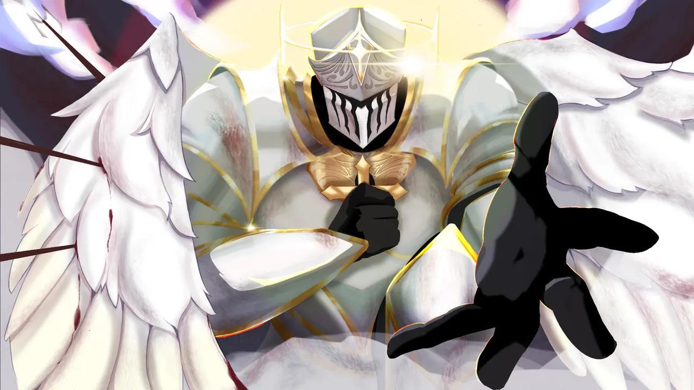

# Ryth

*A melee champion with an area stun and an attack reset. Health also adds Strength.*

## Kit

**Ryth**

**Passive:** Ryth gains Strength equal to 1% of bonus health.

### Slot 0: Area stun

1 × Focus damage and a one-round stun in radius one.

- **Target / range:** Ground · 4
- **Walking:** Excludes walking
- **Cooldown:** 8 owner turn ends

### Slot 1: Attack reset

Resets your basic attack cooldown.

- **Target / range:** Self
- **Walking:** Compatible
- **Cooldown:** 8 owner turn ends

## Starting stats

| Stat | Base | Growth per matching shard |
| --- | --- | --- |
| Health | 1200 | 100 |
| Strength | 45 | 5 |
| Focus | 100 | 10 |

Attack type: Melee. Basic attack range: 1 tiles.

---

**See also:** [Champion roster](./README.md) · [Combat & abilities](../handbook/07-combat.md) · [Items & gold](../handbook/08-items.md)

Engine sources cited by the handbook: `game/Engine/include/private_cpp/Engine/Balance/Champions.h`, `game/Engine/include/private_cpp/Engine/Balance/ChampionPassives.h`, `game/Engine/include/private_cpp/Engine/Abilities/Designs.h`, `game/Engine/include/private_cpp/Engine/Passives/Designs.h`, `game/Engine/src/Game/Combat.cpp`
