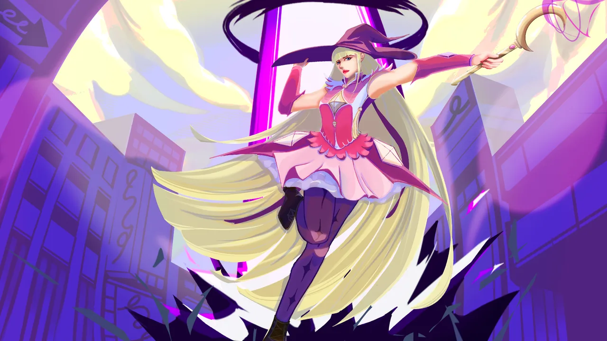

# Stellar

*A ranged spellcaster who chooses between concentrated damage and an area hit.*

## Kit

**Stellar**

### Slot 0: Single-target damage

2 × Focus damage.

- **Target / range:** Enemy or camp · 4
- **Walking:** Excludes walking
- **Cooldown:** 8 owner turn ends

### Slot 1: Area damage

1.4 × Focus damage in radius one.

- **Target / range:** Ground · 4
- **Walking:** Excludes walking
- **Cooldown:** 8 owner turn ends

## Starting stats

| Stat | Base | Growth per matching shard |
| --- | --- | --- |
| Health | 650 | 65 |
| Strength | 30 | 3.5 |
| Focus | 85 | 8.5 |

Attack type: Ranged. Basic attack range: 3 tiles.

---

**See also:** [Champion roster](./README.md) · [Combat & abilities](../handbook/07-combat.md) · [Items & gold](../handbook/08-items.md)

Engine sources cited by the handbook: `game/Engine/include/private_cpp/Engine/Balance/Champions.h`, `game/Engine/include/private_cpp/Engine/Balance/ChampionPassives.h`, `game/Engine/include/private_cpp/Engine/Abilities/Designs.h`, `game/Engine/include/private_cpp/Engine/Passives/Designs.h`, `game/Engine/src/Game/Combat.cpp`
