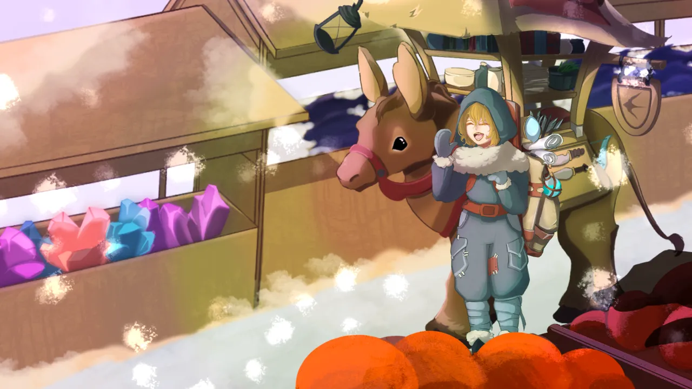

# Tavi

*A ranged champion who can buy equipment in the field and threaten a target with a powerful stunning spell.*

## Kit

**Tavi**

**Passive:** Tavi can buy shards from anywhere on the map, note he cannot buy consumables unless he is on his spawn tiles (or dead). Additionally, Tavi can sell equipment at spawn for its full purchase value. Note, Health bought away from spawn raises maximum health without healing.

### Slot 0: Attack reset

Resets your basic attack cooldown.

- **Target / range:** Self
- **Walking:** Compatible
- **Cooldown:** 8 owner turn ends

### Slot 1: Damage and stun

1.6 × Focus damage and a one-round stun.

- **Target / range:** Enemy or camp · 4
- **Walking:** Excludes walking
- **Cooldown:** 8 owner turn ends

## Starting stats

| Stat | Base | Growth per matching shard |
| --- | --- | --- |
| Health | 900 | 75 |
| Strength | 45 | 5 |
| Focus | 110 | 10 |

Attack type: Ranged. Basic attack range: 3 tiles.

---

**See also:** [Champion roster](./README.md) · [Combat & abilities](../handbook/07-combat.md) · [Items & gold](../handbook/08-items.md)

Engine sources cited by the handbook: `game/Engine/include/private_cpp/Engine/Balance/Champions.h`, `game/Engine/include/private_cpp/Engine/Balance/ChampionPassives.h`, `game/Engine/include/private_cpp/Engine/Abilities/Designs.h`, `game/Engine/include/private_cpp/Engine/Passives/Designs.h`, `game/Engine/src/Game/Combat.cpp`
