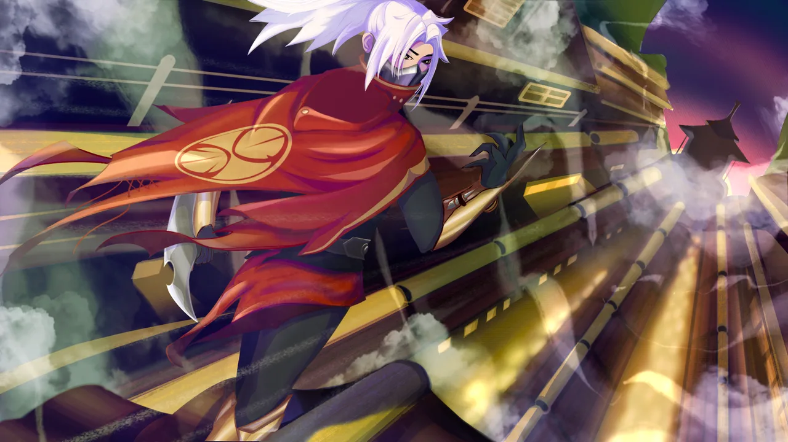

# Vendetta

*A melee attacker whose kills refresh spell cooldowns, with a reset and dash for follow-up plays.*

## Kit

**Vendetta**

**Passive:** When Vendetta gets a kill, she resets all her ability cooldowns. This applies to killing camp monsters too.

### Slot 0: Attack reset

Resets your basic attack cooldown.

- **Target / range:** Self
- **Walking:** Compatible
- **Cooldown:** 8 owner turn ends

### Slot 1: Dash

Move up to 2 steps, including diagonals.

- **Target / range:** Ground · 2 tiles
- **Walking:** Compatible
- **Cooldown:** 8 owner turn ends

## Starting stats

| Stat | Base | Growth per matching shard |
| --- | --- | --- |
| Health | 900 | 100 |
| Strength | 65 | 6 |
| Focus | 100 | 10 |

Attack type: Melee. Basic attack range: 1 tiles.

---

**See also:** [Champion roster](./README.md) · [Combat & abilities](../handbook/07-combat.md) · [Items & gold](../handbook/08-items.md)

Engine sources cited by the handbook: `game/Engine/include/private_cpp/Engine/Balance/Champions.h`, `game/Engine/include/private_cpp/Engine/Balance/ChampionPassives.h`, `game/Engine/include/private_cpp/Engine/Abilities/Designs.h`, `game/Engine/include/private_cpp/Engine/Passives/Designs.h`, `game/Engine/src/Game/Combat.cpp`
