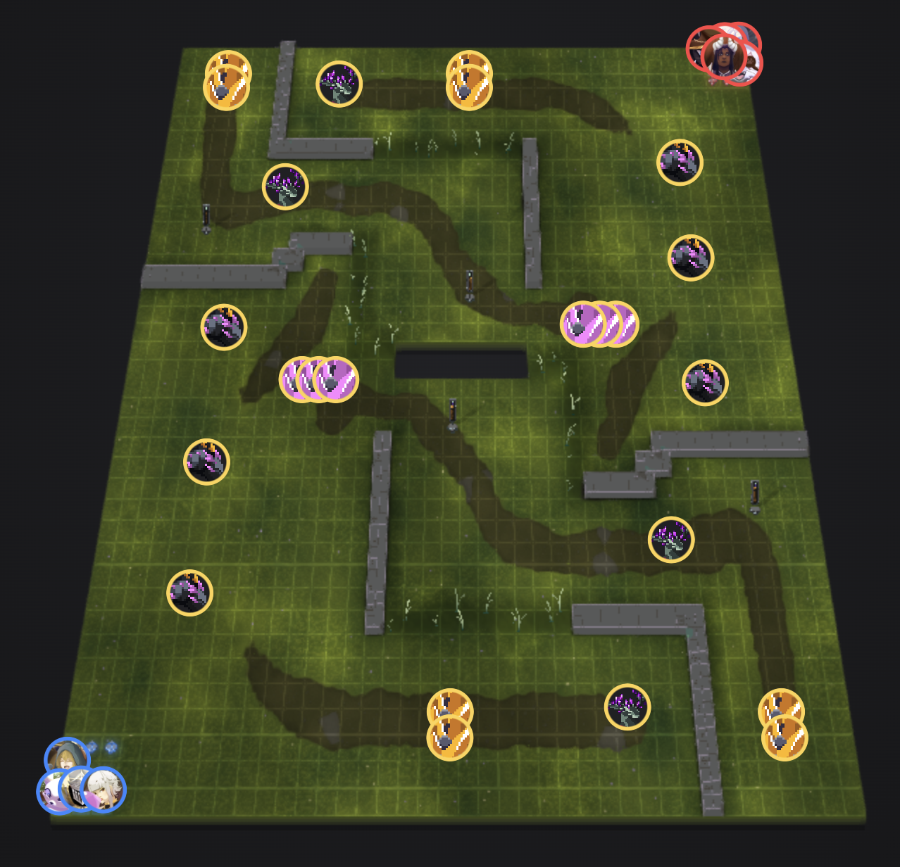

# The game

## Overview

The map is populated with groups of monsters, called camps, that carry 2 valuable resources, gems  and gold

In the game, you control a team of “champions” which are a set of combat units you will use to fight the monsters.

Using code, you must clear the monsters away, obtaining their resources.

The gems dropped are the main objective of the game.

By taking gems collected from clearing camps, and tributing/offering them at altars, you obtain victory points.

The most gems tributed by a team wins the game.

Additionally to gems, camps can drop gold. Gold is a resource used to improve the combat power of your “champions” by giving them more damage, or health.

## How to win

> **Diagram: victory.** The first team to tribute 1,000 gems wins immediately. At the 2,000-round limit, compare tributed gems, then lifetime gold earned, then champion kills. If all tie, Team B wins.

Interactive diagram text

- Tributed gems
- More gems tributed
- Gold earned
- More gold earned all game
- Kills
- More champion kills
- Second team wins
- All tied? Team B, which acted second in round one.
- Race to 1,000 tributed gems
- Your team
- Opponent
- 1,000 wins at once
- If nobody reaches it by round 2,000

The objective of the game is to tribute as many gems as possible! The game ends after a team tributes 1000 gems or round 2000 passes, whichever comes first.

### Tiebreak notes

- The gold tiebreak counts all gold earned, not what is left to spend.
- If tributed gems, gold earned and kills all tie, the team that acted second in round one wins (Team B). The starting team still alternates each round.
- A local runner may stop before round 2,000.

## Obtaining Resources

> **Diagram: journey.** Defeat every monster in a camp group, capture its region to receive gold and gems, then tribute carried gems at an altar. Spend gold to improve your champion.

Interactive diagram text

- Clear
- Defeat every monster in the camp.
- Claim
- Hold the camp uncontested until its five-round capture timer finishes.
- Carry
- This single-wolf camp gives you 4 gems and 40 gold. Get the gems safely to an altar.
- Tribute
- Count down at the end of the starting turn. At your following turn start, your 4 gems become team score.
- Follow one delivery
- Illustrated example
- N: N
- Camp
- Altar
- 4 gems
- Carried
- Tributed
- Follow the delivery

The general flow of the game is to send your champions to defeat camps on the map, collect the gems they drop, then tribute the gems at altars.

Camps can also drop gold, which can be used on the champions' spawn tiles to purchase items making them stronger.

Engine sources cited by the handbook: `game/Engine/include/private_cpp/Engine/Balance/GameSettings.h`, `game/Engine/src/Game/Scheduler.cpp`, `game/Engine/src/Game/Actions.cpp`, `game/Engine/src/Game/Combat.cpp`
