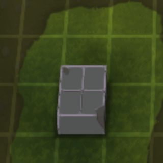
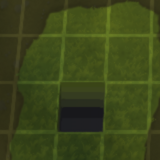
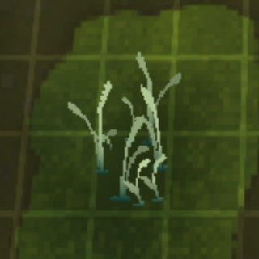
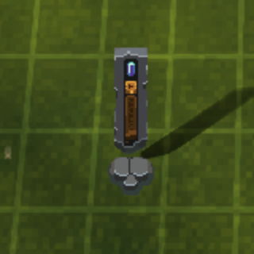

# Maps & movement

*Find a free tile in range. Do not path onto the target itself.*

## Map features

The map is a grid, between 30*30 to 100*100, built from 5 different tiles as shown below:

| Feature | Description |
| --- | --- |
|  Wall | Blocks line of sight, cannot be moved onto nor can it be dashed over. TP Crystal can reach walls. |
|  Holes | Can be seen over, cannot be moved onto but can be dashed over. |
|  Bush | Blocks line of sight, can be moved onto. If you are within a bush, you can see out of the bush. |
|  Altar | Cannot be moved onto, used to submit gems. |

The map also is populated with camps/monsters as outlined in the next section.

## Ways to move

To traverse the map, a champion can move 1 step every turn with their basic move action. Dashes move up to 2 steps, including diagonals, along a legal dash path. Teleport crystals reach up to 3 tiles horizontally and vertically, including diagonals, and ignore terrain between you and the destination.

> **Diagram: movement.** Ordinary movement reaches an adjacent tile in any of eight directions. Melee champions can also attack; ranged champions ordinarily choose one. Dashes use a legal path of up to 2 steps and may cross holes; teleport crystals have range 3 and ignore intervening terrain. Landing cannot be on a wall, hole, altar, enemy spawn or occupied tile.

Interactive diagram text

- Wall
- Hole
- Bush
- Altar
- Open ground
- Your champion
- Movement type
- Dash up to 2 steps, including diagonals. The path may pass over holes and the altar, but not walls, and must end on a legal tile.
- Teleport up to 3 tiles horizontally and vertically, including diagonals, to a legal free tile. Ignores terrain in between.
- N: N legal landing tiles on this sample map.
- ..WW..BB.
- ..W..H.B.
- ..W.CH...
- ....AH...
- .B.....W.
- N,N
- Can land ·

Ask the SDK for your movement mask rather than recomputing walking yourself; it already accounts for the units you can see.

> **Diagram: hidden-blocker.** An unseen enemy in a bush can block a destination included in your observed movement mask. Attempting the step returns false, reveals that tile for the rest of the round and preserves your movement allowance. Choose another free tile and retry. A known occupied destination raises an error.

Interactive diagram text

- Unseen occupant
- Move is blocked
- Choose another tile
- The bush hides an enemy. Your observed movement mask includes its tile because you cannot see the occupant.
- Trying to enter the bush returns false. You stay where you are, and the occupied tile is revealed for the rest of this round. Your movement allowance is still available.
- Choose a free adjacent tile instead. This move returns true and uses your movement allowance. Trying the now-known occupied tile would raise an error.
- An unseen enemy blocks a step
- Illustrated example
- Unknown occupant
- Pause
- Replay
- Play
- N: N
- N (N of N)
- Hidden blocker
- Before
- Retry

> **Hidden enemies still block**
>
> If an otherwise legal destination has an unseen occupant, the action returns `false` without throwing. The blocked tile is revealed to your champion for the rest of the round, and the attempt does not consume your movement allowance, ability cooldown or consumable, so you can try another destination. A destination already known to be occupied raises an error (`cambc::error` in C++). A successful action returns `true`. These rules also apply to dashes and teleport crystals; for a crystal, `true` means its channel started successfully.

---

**See also:** [Vision & wards](./09-vision.md) · [Items & gold](./08-items.md) · [Getting Started](../guides/cpp/first-bot.md)

Engine sources cited by the handbook: `game/Engine/src/Game/World.cpp`, `game/Engine/src/Game/MovementMask.cpp`, `game/cli/readme.md`
