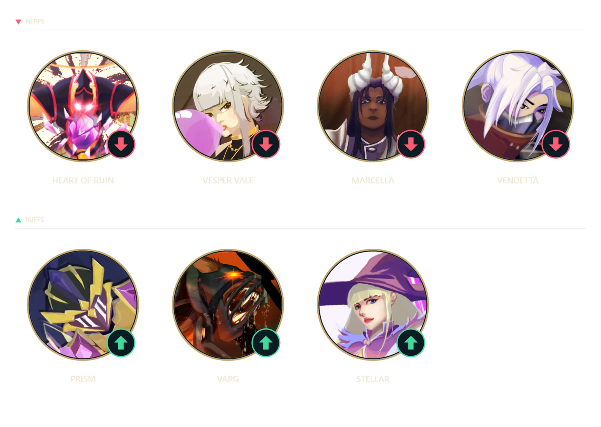
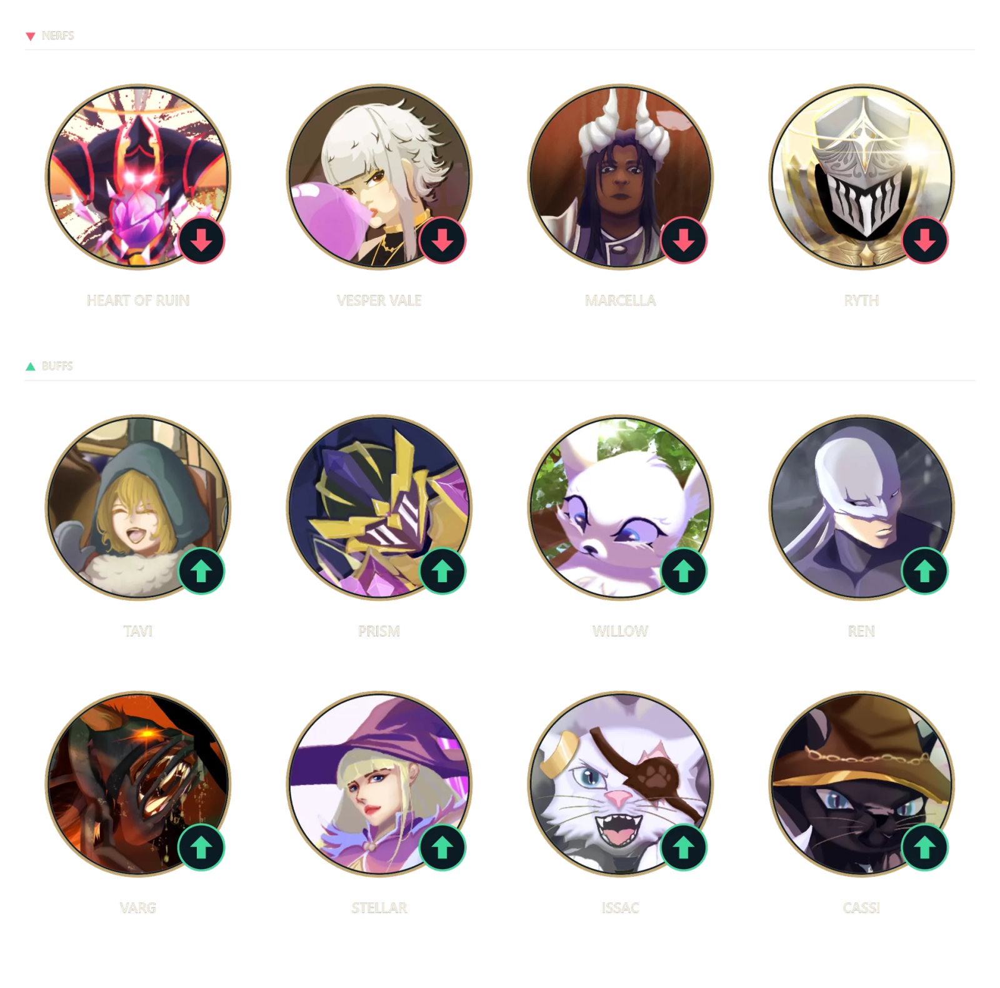
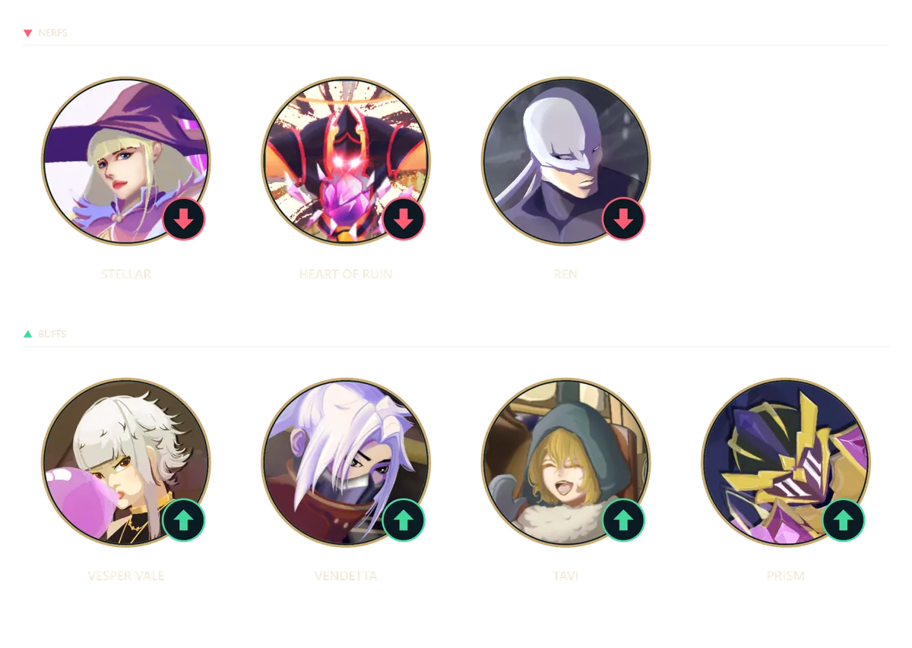
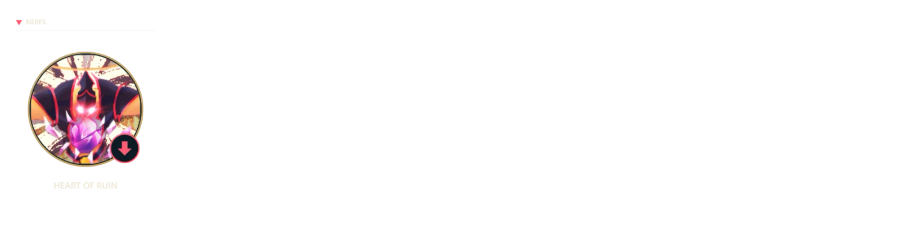
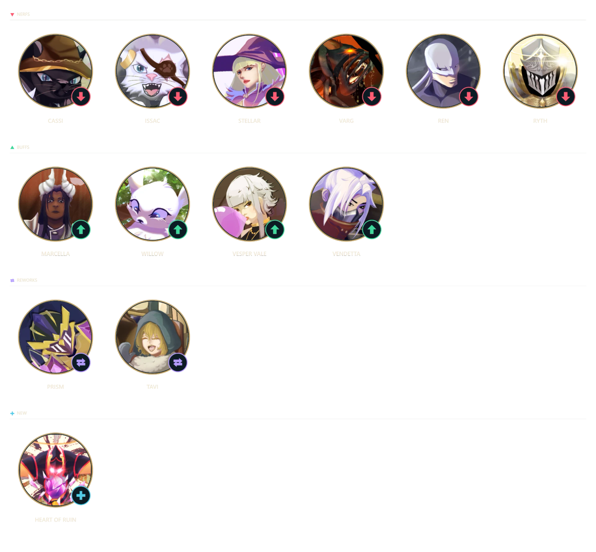
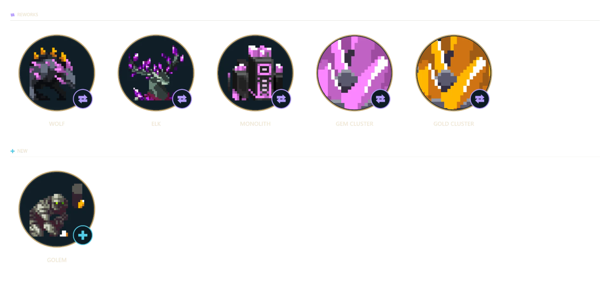

# Patch notes

*Balance changes to champions and the game, newest first.*

## Patch 4.0.0 (2026-11-04)



### Vendetta

- Health: 1000 → 900
- Strength: 70 → 65

### Vesper Vale

- Strength: 45 → 35

### Stellar

- Focus: 70 → 85

### Prism

- Focus: 80 → 90

### Marcella

- Strength: 45 → 40
- Strength per shard: 4.5 → 3.5
- Focus per shard: 14 → 10

### Varg

- Strength: 45 → 50

### Heart of Ruin

- Focus: 100 → 80
- Focus per shard: 10 → 9

---

### Skirmish Emblem

- Bonus damage against champions: 5% → 10%

### Greed Emblem

- Shard value per emblem: 35 → 40

## Patch 2.0.0 Notes - Sprint 3 (2026-10-25)



### Ryth

- Strength per shard: 5 → 4.5

### Vesper Vale

- Strength: 55 → 45

### Cassi

- Focus: 70 → 100

### Issac

- Strength: 40 → 45

### Stellar

- Focus per shard: 7 → 8.5

### Prism

- Health per shard: 60 → 65

### Marcella

- Strength per shard: 5 → 4.5
- Focus per shard: 15 → 14

### Willow

- Focus: 120 → 140

### Ren

- Stun damage (S1): 0.75 x Focus → 1.1 x Focus

### Varg

- Strength: 40 → 45

### Tavi

- Stun damage (S2): 1.4 x Focus → 1.6 x Focus

### Heart of Ruin

- Strength per shard: 3.5 → 3
- Focus per shard: 12 → 10

---

### Treasure Emblem

- Bonus gold: 20% → 10%

### Monster Emblem

- Bonus damage to camps: 10% → 15%

---

### New emblem families

#### Tribute Emblem


- Tribute time: reduced by 33%.
- The resulting duration is rounded up, with a minimum of one turn.

#### Capture Emblem


- Capture time: 5 → 3 turns.
- Applies when at least one allied capturer owns a Capture Emblem as the capture begins.

#### Prospector Emblem


- Bonus gold and gems from clusters: +25%.
- Only the Gold Cluster and Gem Cluster parts of a camp group's rewards contribute to this bonus. Other camps in the group keep their normal rewards.

> **Sharing rewards:** Each capturer who owns a Prospector Emblem receives 25% of their own share as an additional reward, rounded down separately for gold and gems. Capturers without Prospector receive only their normal share.
> 
> For example, 20 cluster gold shared by two allies gives each 10 base gold. A Prospector holder gains 2 extra gold; if both own the emblem, both gain 2 extra.

#### Hunter Emblem


- Additional gold per champion kill: +50.
- Awarded to the champion who gets the kill, before gold-income bonuses are applied.

#### Skirmish Emblem


- 5% more damage to champions.

#### Greed Emblem


- No passive. Combines at 25 shards (750 gold) to give 35 shards worth of stats points.

### Collectors Emblem


- +1% bonus damage per unique completed emblem family owned.
- Collectors counts its own family, so owning only a Collectors Emblem gives 1% bonus damage.
- Different stat variants and duplicate copies of the same family count only once. Shards do not count.

---

### System changes

Increased draft first turn fuel limit by x10!

---

### CLI 4.0.0

You can now select an opponent's historical bot version for an unranked match group, using a previous match-group UUID or website link, just like on the website:

```sh
cambc match-groups create OPPONENT_TEAM_UUID --source-group MATCH_GROUP_UUID_OR_LINK
```

You can also list your team's submitted bot versions and change which version is live:

```sh
cambc submissions list
cambc submissions list --before 10 --json
cambc submissions activate 7
cambc submissions activate latest
```

---

### Breaking SDK details

This patch uses **engine 2.0.0** and **CLI 4.0.0**. Update your local CLI and rebuild your bot with the updated SDK before testing against the new engine.

The item backpack has expanded from **42 to 84 item types**. If you maintain custom WASM bindings, `env.champion_items` keeps its name and arguments but now writes **84 little-endian `u32` counts (336 bytes)**. Its output buffer must be expanded accordingly.

### Camp capture state

The SDKs now expose capture progress alongside the existing camp-group state query. The result has `timer` and `state` fields:

| State | Meaning |
| --- | --- |
| Ally capturing | You or an ally are capturing the group. |
| Contested | Both teams are present, blocking capture. |
| Enemy capturing | The opposing team is capturing the group. |
| Capture available | The group's reward is available, but no one is capturing. |
| No capture available | The camp group is still alive or waiting to respawn. |

While either team is capturing, `timer` reports the remaining capture countdown, including the shorter countdown from a Capture Emblem. In all other states it returns the normal maximum of 5 turns.

The group must be in your current vision to view its capture state, though the champion performing the capture does not need to be in vision.

### Item enum helper

You can now select an item by family and stat, instead of looking up one of the 84 item names:

| Language | New helper |
| --- | --- |
| C++ | `cambc::get_item_enum(item_family family, item_stat stat, bool shard = true)` |
| Python | `cambc.get_item_enum(family: ItemFamily, stat: ItemStat, shard: bool = True)` |
| Rust | `cambc::get_item_enum(family: ItemFamily, stat: ItemStat, shard: bool)` |
| OCaml | `Cambc.get_item_enum: ?shard:bool -> Item_family.t -> Item_stat.t -> Item.t` |

## Patch 1.0.2 Notes (2026-10-21)



### Stellar
- Health: 750 → 650
- Health per shard: 75 → 65
- Focus: 85 → 70
- Focus per shard: 9 → 7


### Heart of Ruin
- Strength: 40 → 30
- Strength per shard: 4 → 3.5
- Dash landing damage (S2): 1.75 x Focus → 1.5 x Focus


### Ren
- Stun damage (S1): 1.25 x Focus → 0.75 x Focus

Focus champions have a lot of front loaded damage, which has been hard to play around. These champions also have extremely high pick rates all across the board and so we are lowering their output.

---

### Vesper Vale
- Health: 900 → 1000
- Strength: 50 → 55

### Vendetta
- Health: 800 → 1000

### Tavi
- Health: 750 → 900
- Focus: 100 → 110

Strength champions are struggling to endure the amount of burst in the game, so we are giving them a bit more health to help them through early game combats

---

### Prism
- Passive focus per gem: 1 → 1.5

Prism has not seen any usage in higher ranked play, hopefully these changes will encourage teams to build a specialist strategy around them

## Patch 1.0.1 Notes (2026-10-20)



### Heart of Ruin
We have made an emergency nerf to Heart of Ruin due to near 100% usage rates in top ladder:
- Strength per shard: 5 → 4
- Focus per shard: 15 → 12

### Important Ladder Changes
- Previously, new patches that caused compilation errors would remove your bot from matchmaking and you could essentially freeze your elo
- This has now been changed such that your team will be marked as having an out of date submission ("invalid bot") and you will have a grace period for 24 hours to patch it before you will start auto losing ranked matches.
  - The site will alert you if you are in this situation and need to submit a new bot

## Patch 1.0.0 Notes - Week 2 (2026-10-20)



### Cassi
- Health: 700 → 600
- Health per shard: 71.25 → 65
- Strength per shard: 3.5 → 3
- Focus per shard: 15 → 13

### Issac
- Health per shard: 95 → 80
- Strength per shard: 4.75 → 3

We felt that Cassi and Issac was overly picked on every map and thus are toning them down a little. We wish to keep their niche of having the highest base stats (combined) in the early game, but heavily reduce their scaling into mid-late game.

### Stellar
- Focus: 100 → 85
- Strength: 35 → 30
- Focus per shard: 10 → 9

Stellar was the premier ranged DPS overshadowing many of the other champions and so we are toning her down.

### Varg
- Strength: 50 → 40

Varg has had a ton of presence across all maps thanks to his AoE attacks, however he was too good at clearing single camps with his high base strength. We are toning this down whilst hopefully keeping his niche for large camp groups.

### Ren
- Strength: 40 → 35
- Focus per shard: 10 → 9

Ren is a champion that can generally do everything as long as he had the stats, we felt that he was able to come online too early and thus are reducing his scaling slightly.

### Ryth
- Strength: 50 → 45

Like Varg, has had a ton of presence with his high base strength and AoE damaging ability (S1). We wish to tone down his single target damage a little.

---

### Marcella
- Passive: Gain 2 gold per gem tributed and has stun immunity
- Focus: 50 → 60
- Focus per shard: 10 → 15

Marcella lacked presence due to her simple kit, with this buff and change to her passive we hope to bring her presence up this week!

### Willow
- Strength: 45 → 55
- Focus: 105 → 120

As the only healer in the game, Willow holds a special role but simply was not efficient to build items on. We are going to lean into this and push Willow towards early game power and sustain to help other weaker early game champions scale or push tempo with the ability to stay on the map for longer.

### Vesper Vale
- Passive bonus gold: 20% → 33%
- Strength: 45 → 50

Vesper vale has been one of the weaker champions in the game, we have decided to buff her early game power and gold income to help her hit her power spikes sooner.

### Vendetta
- Strength per shard: 5 → 6

We think that vendetta is in a decent spot, but struggles to scale well with items and thus are giving her a little nudge.

---

### Prism
- Passive focus per gem: 0.2 → 1
- Health per shard: 75 → 60
- Strength per shard: 3.5 → 2.5
- Focus per shard: 10 → 8

Prism saw very little play, only really used with Stellar to cheese camps from out of their range as he has 2 ranged damaging abilities. By increasing his gem scaling and reducing his stat scaling we hope to bring prism into his intended playstyle as a high risk mage.

### Tavi
- Stun damage (S2): 2.2 x Focus → 1.4 x Focus
- Strength: 35 → 45

Tavi was incredibly strong last patch due to their high damage multipler and we intend to tone this down shifting them more into a strength focussed character.

---

### Heart of Ruin

- **Melee**
- **Passive**: Increases damage dealt by up to 50% based on missing % health. (50% bonus damage at 0% health, 25% bonus damage at 50% health, 0% bonus damage at 100% health)
  - This applies to all damage sources (abilities + basic attack)

- Health: 1000 (+100 per shard)
- Strength: 40 (+5 per shard)
- Focus: 100 (+15 per shard)

- **S1**: Shield self for 1.5 * Focus for 5 turns
- **S2**: 2-tile range dash. Upon landing at the destination, deals 1.75 * Focus and stuns enemies/camps for 1 turn within 1 chebyshev radius of the landing location.

We are happy to introduce our 12th and final champion, Heart of Ruin!



### Wolf
- Gems: 22 → 4
- Gold: 90 → 40
### Elk
- Gems: 36 → 15
- Gold: 160 → 90
- Range: 3 → 4
### Gem cluster
- Health: 500 → 120
- Gems: 24 → 7
### Gold cluster
- Health: 500 → 120
- Gold: 35 → 20
### Monolith
- Range: 3 → 5

We felt that games were ending way to quickly, and so are toning down gold and gem income per camp.
The listed numbers are so low as we plan to alter the value of camp groups through the use of Gem and Gold clusters as we can add clusters to increase the groups gem or gold value without increasing clear difficulty by much.

We've noticed some camps getting cheesed by Stellar, Prism, Ryth and other champions that have long ranged damage and have thus decided to increase the range of some camps to nerf this form of farming.

### Golem (new)
- Health: 5000
- Strength: 120
- Range: 4
- Gold: 160
- Gems: 36
- Respawn: 80 rounds

Monolith has been very difficult to fight and often too hard to work towards on some maps, so we are adding Golem as a bridge between the regular camps and Monolith.

---

### Kill reward
- Gold: 50 → 100

We want to incentivise more aggressive strategies such as invades and contesting camps, and to do this we are raising the kill reward.

### Wards
- Cooldown: 1 → 10

We found that being able to ward every round allowed champions to essentially sweep bushes very quickly which is not intended. By increasing the ward cooldown placement has to have a little more thought behind it.

### Altar Lock HP
- Health: 3 → 5

Many champions have a form of attack reset which lets them clear altar locks incredibly quickly. We hope to remedy this by increasing altar lock hp slightly.

---

### Breaking SDK details

With the new balance patch, the SDK has changed adding new Enum values for both the new camps and champions. Adjustments to the dash ability data structure has also been made adding `ability_dash`/`AbilityDash`.

Old submissions that relied on these patterns will now fail to compile. The teams with these submissions will be removed from matchmaking until they upload a new working submission.
